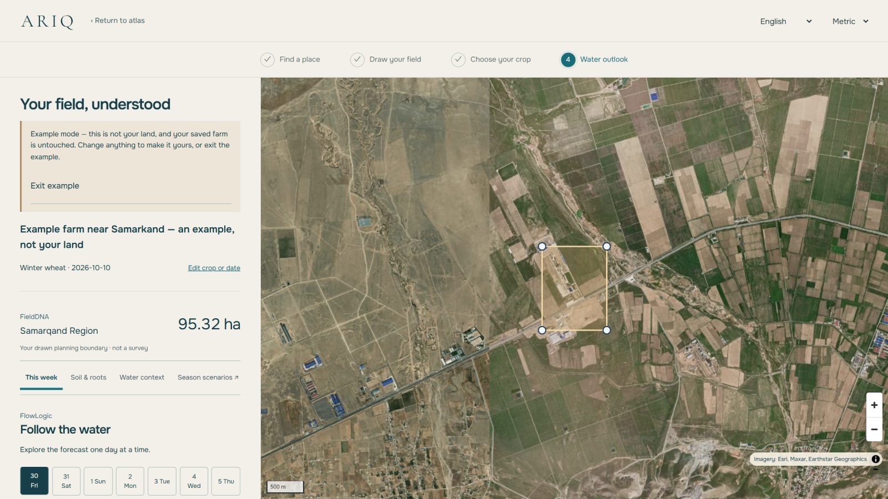

<div align="center">


# ARIQ

### Water intelligence, reimagined.

**Every field has a story. ARIQ reads it.**

[🌐 **Live: ariq-private.nezzoval.workers.dev**](https://ariq-private.nezzoval.workers.dev/)

English · [O'zbekcha](#ozbekcha) · [Русский](#русский)

</div>

---

## English

ARIQ is an agricultural water-intelligence platform built for Uzbekistan — a country where farming, rivers and survival are the same conversation.

A farmer draws a field on a sculptural 3D atlas of the country. ARIQ reads that land: its modelled soil, the weather moving over it, the rivers and canals documented around it. Then it does the quiet mathematics of water — crop demand, soil-water depletion, stress deadlines, delivery feasibility — and answers in plain language: *what your land needs, when it needs it, and what happens if the water doesn't come.*

- **FieldDNA** — location-specific SoilGrids soil intelligence with honest uncertainty, never dressed up as a lab result.
- **FlowLogic** — FAO-56 irrigation scheduling that schedules *before* stress deadlines and says exactly which constraint stopped the water.
- **TerraPulse** — ERA5-Land soil-moisture scenarios: wetter, central, drier — labelled as scenarios, not promises.
- **Water Futures** — full-season what-if simulation: drought, supply cuts, planting shifts, crop switches, compared side by side.
- **HydroAtlas** — a nationwide, provenance-carrying inventory of rivers, canals, reservoirs and structures. Proximity is never sold as access.
- **A Meta-model Copilot** — an AI layer that operates the deterministic engines through validated tools. The numbers always come from the models, never from the model's imagination. *(Live on the public site: server-side key, a hard $5 Durable-Object budget, validated tools only.)*



The future of irrigation starts with understanding the land.

## O'zbekcha

ARIQ — O'zbekiston uchun yaratilgan qishloq xo'jaligi suv intellekti platformasi.

Dehqon o'z dalasini mamlakatning uch o'lchamli atlasi ustida chizadi. ARIQ shu yerni o'qiydi: uning tuproq modelini, ustidan o'tayotgan ob-havoni, atrofida hujjatlashtirilgan daryo va kanallarni. So'ng suvning sokin hisobini bajaradi — ekin talabi, tuproq namligining kamayishi, stress muddatlari, suv yetkazish imkoniyati — va oddiy tilda javob beradi: *yeringizga nima kerak, qachon kerak va suv kelmasa nima bo'ladi.*

Dala miqyosidagi tuproq tahlili, FAO-56 sug'orish jadvali, mavsumiy simulyatsiya va butun mamlakat suv infratuzilmasi — barchasi bitta tizimda, har bir raqam o'z manbasi bilan. Bu shunchaki kalkulyator emas. Bu O'zbekiston qishloq xo'jaligining kelajagi uchun qurilgan qaror qabul qilish tizimi.

## Русский

ARIQ — платформа сельскохозяйственного водного интеллекта, созданная для Узбекистана.

Фермер очерчивает своё поле на скульптурном 3D-атласе страны. ARIQ читает эту землю: модель её почвы, погоду над ней, задокументированные реки и каналы вокруг. Затем выполняет тихую математику воды — потребность культуры, истощение почвенной влаги, сроки стресса, возможность подачи — и отвечает простым языком: *что нужно вашей земле, когда это нужно и что будет, если вода не придёт.*

Почвенный анализ уровня поля, график полива по FAO-56, сезонное моделирование сценариев и водная инфраструктура всей страны — в одной системе, где каждое число несёт свой источник. Это не калькулятор. Это система принятия решений для сельского хозяйства, которое кормит страну.

---

## Technology

| Layer | Stack |
|---|---|
| Application | Next.js 16 · React 19 · TypeScript |
| 3D atlas | Three.js / React Three Fiber — real-elevation relief cut to Uzbekistan's border |
| Farm maps | MapLibre GL · Esri World Imagery (attributed) |
| Runtime | Cloudflare Workers · rate-limited public APIs |
| Science | FAO-56 ET₀ & scheduling · FAO-33 yield response · Saxton–Rawls soil water · ERA5-Land scenarios |

**Scientific methods.** Penman–Monteith ET₀ (FAO-56), stage crop coefficients, daily soil-water balance with stress thresholds, canal-capacity and supply-constrained allocation, FAO-33 relative yield response. All calculations are deterministic, SI-internal, and tested against published benchmarks. Modelled estimates are labelled as modelled — satellite and reanalysis values are never presented as field measurements. Full detail: [docs/DATA_SOURCES.md](docs/DATA_SOURCES.md) · [docs/ARIQ_FEATURE_SYSTEMS.md](docs/ARIQ_FEATURE_SYSTEMS.md) · [docs/ai-water-copilot.md](docs/ai-water-copilot.md)

## Run it

```bash
npm ci
npm run dev        # local development
npm test           # 200+ deterministic tests
npm run verify     # typecheck + tests + production build
npm run verify:cloudflare   # Cloudflare build + dry-run deploy check
```

The AI Copilot runs on Meta Muse Spark (Standard mode) behind a hard Durable-Object budget ($5 total, $1/day defaults) with reserve-before-call accounting. It activates only with a server-side key (`ARIQ_COPILOT_ENABLED=true`, `MODEL_API_KEY`); without one it returns an honest unavailable state and every scientific feature works unchanged.

## Attribution & license

Code is released under the [MIT License](LICENSE). Data and assets remain under their original terms — OpenStreetMap (ODbL), ISRIC SoilGrids (CC BY 4.0), Open-Meteo (CC BY 4.0), Copernicus ERA5-Land, Esri World Imagery, OFL-licensed fonts. See [NOTICE.md](NOTICE.md) and [docs/DATA_SOURCES.md](docs/DATA_SOURCES.md) before redistributing data.
