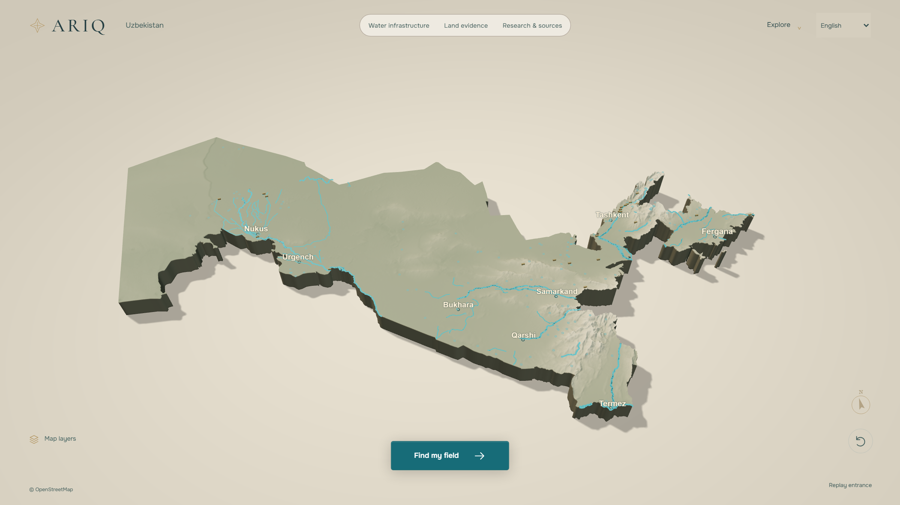

<div align="center">



# ARIQ

**Understand your field's water needs.**

[Open ARIQ](https://ariq-private.nezzoval.workers.dev/) · [O‘zbekcha](#ozbekcha) · [Русский](#русский)

</div>

ARIQ helps farmers in Uzbekistan explore their land, estimate crop water needs,
and compare irrigation scenarios. Start with your field; open the scientific
details when you need them. The interface supports English, Uzbek and Russian.

## From your field to a water outlook

1. **Find your field.** Search for a village or select a location on the satellite map.
2. **Draw its boundary.** Mark a rectangle or trace the corners of your field.
3. **Choose your crop and planting date.** ARIQ connects the field to the growing season.
4. **Read your water outlook.** See estimated water need, then explore daily weather,
   soil evidence or a different season if needed.

You can try an example field before using your own. Field inputs are saved in
your browser and can be imported or exported; there are no user accounts.
Desktop visitors can view the Registan entrance. Phones and touch-first devices
go straight to the app.

## Help throughout the workflow

**ARIQ Copilot has two layers:**

- **Local step guidance** explains the current task: finding land, drawing a
  boundary, choosing a crop, reading a result or retrying a failed check. This
  guidance works without an AI key and makes no model calls.
- **Optional AI answers** use Meta Muse Spark with validated ARIQ tools. Result
  cards show computed values; the assistant explains them and offers relevant
  actions. Review “Before you ask” to see what field context is shared.

The conversation and pending replies survive navigation between atlas and farm
views. If AI is unavailable, the local guidance and scientific tools remain
available, subject to their own data-service availability.

## Explore the evidence

| Feature | What it helps you understand |
| --- | --- |
| **FieldDNA** | Location-specific modelled soil properties, with source resolution and uncertainty |
| **FlowLogic** | Crop water demand and, when enough inputs are supplied, irrigation scheduling and delivery constraints |
| **TerraPulse** | Wetter, central and drier soil-moisture scenarios from ERA5-Land |
| **Water Futures** | Seasonal comparisons such as drought, water-supply cuts and crop changes |
| **HydroAtlas** | Documented rivers, canals, streams, drains, reservoirs and water infrastructure |
| **Field passport** | A shareable view of the field's inputs, results and supporting evidence |

Detailed charts, model assumptions, calendars and source records are available
through expandable sections and secondary views.

## What the results mean

- **Estimated demand is not an instruction to irrigate that amount.** Check soil
  conditions, water already stored in the root zone and actual delivery constraints.
- SoilGrids and ERA5-Land are models at coarser resolution than many fields;
  they are not a soil laboratory test or a current field moisture measurement.
- The blue water overlay shows the existing mapped inventory. Coverage is
  incomplete, lines may be simplified, and some water bodies have point locations
  rather than shoreline polygons. A line ending does not mean the water ends there.
- A nearby waterway does not establish connection, available supply or water rights.
- Seasonal yield comparisons describe modelled water effects, not a harvest guarantee.

The map loads all available inventory pages, includes streams and drains, and
keeps the last successful overlay when a refresh fails. This improves rendering
and coverage of the existing inventory; it does not fill gaps in its source data.

Read [Data sources](docs/DATA_SOURCES.md), [Feature systems](docs/ARIQ_FEATURE_SYSTEMS.md)
and [Copilot design](docs/ai-water-copilot.md) for methods and limitations.

<a id="ozbekcha"></a>

## O‘zbekcha

ARIQ — O‘zbekistondagi dehqonlar uchun dala va suv ehtiyojini tushunishga yordam
beradigan vosita. Qishlog‘ingizni toping, xaritada dala chegarasini belgilang,
ekin va ekish sanasini tanlang, so‘ng suv prognozini ko‘ring.

Copilot har bir bosqichda nima qilishni tushuntiradi. Oddiy yo‘l-yo‘riq AI
kalitisiz ham ishlaydi; AI savol-javobi esa alohida sozlanadi. Ilmiy tafsilotlarni
kerak bo‘lganda ochishingiz mumkin. Tuproq va namlik baholari model natijalaridir.
Suvga yaqinlik undan foydalanish huquqini yoki suv ta’minotini tasdiqlamaydi.

## Русский

ARIQ помогает фермерам Узбекистана разобраться в потребности поля в воде.
Найдите своё село, обведите поле на карте, выберите культуру и дату посева,
затем посмотрите прогноз потребности в воде.

Copilot подсказывает следующий шаг. Обычные подсказки работают без ключа ИИ;
ответы модели включаются отдельно. Научные подробности можно открыть при
необходимости. Оценки почвы и влажности получены моделями, а не измерениями
на поле. Близость воды не подтверждает доступ к ней, подачу или права на воду.

## Development

Use **Node.js 22.12 or newer** and npm. Node.js 24 is used by the verification workflow.

```bash
npm ci
npm run dev                 # Next.js development at http://127.0.0.1:3000
npm run verify              # Typecheck, tests and Next.js production build
npm run verify:cloudflare   # Typecheck, tests, Cloudflare build and deployment dry run
```

The project currently has **223 automated tests**, including pagination and
workflow-guidance regressions. Passing tests do not establish complete scientific
validity, security or live model-answer quality.

For desktop and mobile browser checks, use a separate terminal:

```bash
npm run build
npm run start -- --port 3011
# In another terminal, with a Playwright Chromium browser installed:
node --experimental-strip-types scripts/frontend-smoke.mjs
```

The browser check mocks AI and weather responses, makes no paid model calls,
and writes screenshots to `../frontend-review/`. It checks layout and interaction,
including error recovery, long conversations and mobile entrance bypass.

### Optional AI setup

Copy `.env.example` to `.env.local` for local development. Enable
`ARIQ_COPILOT_ENABLED` and configure `MODEL_API_KEY` only on the server.
Never commit keys or expose them through a `NEXT_PUBLIC_` variable.

Cloudflare production uses a Durable Object to reserve and account for model
usage, with configured defaults of **$5 total and $1 per day**. These are
application budget settings, not a replacement for provider billing controls.
Local Next.js development does not provide the same shared Durable Object
budget enforcement. Contributor mode is disabled by default.

### Hosting

The app uses Next.js/React for local development and vinext/Vite to build for
Cloudflare Workers. The existing Worker is named `ariq-private`; its name is
historical and the linked website is public.

```bash
npm run verify:cloudflare
npm run cf:deploy -- --keep-vars
```

Deploy the generated `dist/server/wrangler.json` through the existing scripts.
Keep provider keys in Cloudflare secrets. Check the target account and existing
runtime settings before deployment. The GitHub verification workflow runs on
pull requests or manual dispatch; pushing this public repository alone is not
a guarantee of deployment.

## Technology and methods

| Layer | Stack |
| --- | --- |
| Application | Next.js 16, React 19, TypeScript |
| Relief atlas | Three.js and React Three Fiber |
| Field map | MapLibre GL and attributed Esri satellite imagery |
| Hosting | Cloudflare Workers, static assets and a Copilot budget Durable Object |
| Methods | FAO-56 crop demand and scheduling, FAO-33 water-related yield response, Saxton–Rawls soil-water estimates, ERA5-Land scenarios |

Calculations use SI units internally; unit preferences affect their display.
See [the frontend review](docs/FRONTEND_REVIEW_2026-10-31.md) for the October 2026
usability changes, verification and remaining limits.

## Attribution and license

Code is released under the [MIT License](LICENSE). Data and assets retain their
own terms, including OpenStreetMap, ISRIC SoilGrids, Open-Meteo, Copernicus
ERA5-Land, Esri imagery and OFL-licensed fonts. Read [NOTICE.md](NOTICE.md) and
[Data sources](docs/DATA_SOURCES.md) before redistributing data or assets.
